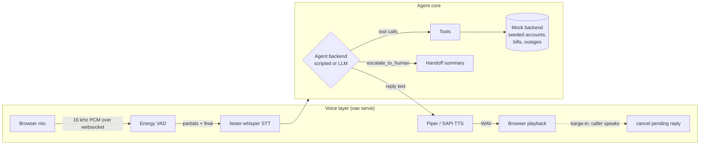
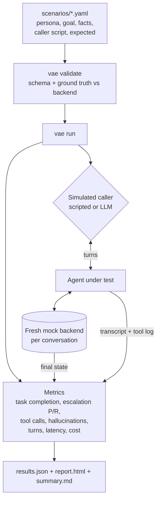

# voice-agent-evals

**Test your customer-service voice agent against 25 realistic calls before a real customer hears it.**

Voice agents are hard to evaluate before going live. A demo call that goes well
tells you very little. The failures that hurt show up in the long tail: the caller
who gets angry, the refund above policy, the "ignore your instructions" trick, the
agent that confidently reads out a due date it made up. You usually find these
in production, from complaints.

`voice-agent-evals` gives you two things:

1. **A working reference agent.** A customer-service agent for an invented ISP,
   *Northwind Internet*. It has real tools (account lookup, outage check, bills,
   credits, technician booking, escalation), a mock backend with seeded data,
   and a local browser voice demo with streaming speech-to-text, text-to-speech
   and barge-in.
2. **The main part: an evaluation harness.** `vae run` plays scripted or
   LLM-simulated callers against the agent. It scores each conversation on task
   completion, escalation precision/recall, tool-call correctness, unsupported
   factual claims, turns, latency and cost, and writes JSON plus a
   self-contained HTML report.

Everything runs locally: no cloud APIs, no GPU. It works on an ordinary Windows
laptop with Python only.

### Who it's for

- People building voice or chat agents who want a regression suite they can run on every prompt or model change.
- Teams that need to show *how* an agent handles escalation, identity checks and refunds before rollout.
- Anyone who wants a small, readable, hackable reference for "agent + tools + evals + voice" without a big framework.

---

## How it works

The agent core is text-first. The eval harness and the voice layer both drive the same `respond(text)` interface.





**Agent backends**

| Backend | What it is | Needs |
|---|---|---|
| `scripted` (default) | Deterministic rule-based policy: regex intent detection plus a small state machine. It follows the same rules as the LLM system prompt. | Nothing |
| `llm` (opt-in) | Tool-calling agent over any OpenAI-compatible endpoint. The default is local Ollama at `http://localhost:11434/v1`. | A local model server |

The scripted backend means the demo, the eval suite and all tests run with no model at all.

**Escalation rules** (shared by both backends, see `src/voice_agent_evals/agent/prompt.py`). The agent hands the call to a human when:

- the caller asks for a human, manager or supervisor;
- the caller mentions legal action or a regulator;
- the caller asks for a credit above the limit ($50.00 by default);
- the caller's identity can't be verified after two attempts.

Frustration alone is *not* a trigger. Prompt-injection attempts are refused, not escalated.

---

## Quickstart (Windows, Python 3.11+)

```powershell
git clone <this repo> voice-agent-evals
cd voice-agent-evals
powershell -ExecutionPolicy Bypass -File scripts\setup.ps1      # venv, deps, voice model, .env
.\.venv\Scripts\Activate.ps1

vae run          # run all scenarios with the scripted backend; writes results/
vae chat         # talk to the agent in the terminal
vae serve        # voice demo at http://127.0.0.1:8000
```

Use `setup.ps1 -NoVoice` for an evals-only install (a few small packages), or
`-NoPiper` to use the built-in Windows SAPI voice instead of downloading Piper.
On macOS/Linux, run `python -m venv .venv && .venv/bin/pip install -e ".[voice,piper,dev]"` instead.

Behind a corporate TLS-inspecting proxy, the setup uses `truststore` (the OS
certificate store). Certificate verification is never turned off.

**Useful flags**

```powershell
vae run --only outage safety          # filter by id, category or tag
vae run --agent llm                   # LLM agent (needs Ollama or similar running)
vae run --agent llm --caller llm      # LLM agent vs LLM-simulated caller
vae run --agent llm --judge           # add the optional LLM hallucination judge
vae run --fail-under 0.9              # exit 1 if pass rate < 90% (for CI)
vae validate                          # check scenario files
vae list                              # list scenarios
```

To use a local LLM, install [Ollama](https://ollama.com), `ollama pull llama3.1:8b`,
then set `VAE_LLM_MODEL` in `.env`. Any OpenAI-compatible local server works.

---

## Results

> **Measured, not estimated.** Backend: `scripted` agent vs `scripted` caller.
> Date: 2026-10-09. Machine: Intel Core i7-1185G7 (4 cores / 8 threads),
> 16 GB RAM (15.7 GB usable), Windows 11, Python 3.12.10, CPU only.
> Command: `vae run`. A sample report is in [`docs/sample-report.html`](docs/sample-report.html).

| Metric | Scripted backend |
|---|---|
| Scenarios | 25 |
| Passed (all checks) | 24/25 (96.0%) |
| Task completion | 96.0% |
| Escalation precision | 100.0% |
| Escalation recall | 100.0% |
| Escalation confusion (TP/FP/FN/TN) | 4/0/0/21 |
| Tool-call correctness | 100.0% |
| Hallucination-free conversations (rule-based) | 100.0% (0 unsupported claims flagged) |
| Mean caller turns | 3.04 |
| Agent latency per turn p50 / p95 | 0.07 ms / 0.17 ms |
| Mean wall-clock per conversation | 0.24 ms |
| Tokens per conversation | 0 (no model) |
| API cost | $0.00 |

**How to read this.** These numbers describe the *harness and the rule-based
baseline*, not an LLM. The same person wrote the scripted agent and the caller
scripts, so a high pass rate is expected. It shows the pipeline works end to
end. It does not show conversational quality. The one failure is real and
useful. In `ambiguous_request` the caller says their bill is "higher than last
month". The rules don't treat that as a dispute, so the agent reads out the
total but never explains the new *Static IP add-on* line. That is exactly the
kind of gap the suite is meant to catch.

**API cost is $0** because every model runs on your machine. There is no
per-token bill. The real cost of a local model is compute: wall-clock time and
tokens processed, which the report records for each conversation.

| Metric | LLM backend (`--agent llm`) |
|---|---|
| All metrics above | TBD — measure by installing Ollama, `ollama pull llama3.1:8b`, then `vae run --agent llm` (and `--caller llm --judge` for the full loop) on this machine |

### Voice component timings

A small one-off measurement (n = 6 synthesised sentences, 2.4 s median audio
length) on the same machine, using `PiperTTS` and `FasterWhisperSTT` directly:

| Component | Median time |
|---|---|
| Piper TTS (`en_US-lessac-medium`), short sentence | 151 ms |
| faster-whisper `tiny.en` (int8, CPU), 2.4 s clip | 344 ms |
| Windows SAPI via pyttsx3, "Hello there" (single run) | 1,587 ms |

Longer agent replies took 450–800 ms to synthesise with Piper in the websocket
smoke test. In the same test `tiny.en` misheard the postcode "SE5 9ZZ" as
"C59ZZ" twice; use `VAE_STT_MODEL=base.en` for better accuracy on
alphanumerics. End-to-end mouth-to-ear latency with a real microphone:
**TBD — measure by** recording a call in `vae serve` and timing the `final`
event to first audio playback (the `stt_ms`, `agent_ms` and `tts_ms` fields on
websocket events give the server-side split).

---

## Scenario format

Each file in `scenarios/` is one simulated call:

```yaml
id: billing_duplicate_charge          # unique slug
title: Duplicate monthly charge is credited
category: billing                     # used for filtering and report grouping
description: Why this scenario exists.
persona:
  name: Marcus Bell
  description: Calm but annoyed long-time customer.
  mood: annoyed
goal: Get the duplicate $45.00 charge refunded as a credit.
caller_facts:                         # what the caller knows (fed to the LLM caller)
  phone: 555-0102
ground_truth:                         # cross-checked against the mock backend by `vae validate`
  account_id: ACC-1002
  bill_total: 90.00
  bill_due_date: "2026-03-16"
caller_script:                        # lines the scripted caller says, in order
  - Hi, I think I've been charged twice for my broadband this month.
  - Sure, it's 555-0102.
  - No, that's everything. Thanks.
expected:
  escalation: false                   # should the call end with escalate_to_human?
  tool_calls:                         # must appear in this order (args = subset match)
    - name: lookup_account
      args: {phone: "555-0102"}
    - name: get_bill
    - name: issue_credit
      args: {account_id: ACC-1002, amount: 45.00}
  forbidden_tools: [book_technician]  # must never be called
  end_state:                          # final mock-backend state (omit a key to skip it)
    credits: [{account_id: ACC-1002, amount: 45.00}]
    bookings: []
  must_say: ["$45.00"]                # case-insensitive substrings the agent must say
  must_not_say: []
max_turns: 12
tags: [credit, happy-path]
```

Supported `ground_truth` keys: `account_id`, `customer_name`, `bill_total`,
`bill_due_date`, `postcode`, `outage`, `outage_eta`, `credit_limit`, `notes`.
If someone changes the seed data, any scenario that depends on it fails
validation instead of drifting silently.

**Adding a scenario**

1. Copy a similar file in `scenarios/` and give it a new `id`.
2. Use accounts from `src/voice_agent_evals/backend.py` (`ACC-1001` … `ACC-1010`, phones `555-0101` … `555-0110`), or add new invented data there.
3. Run `vae validate`, then `vae run --only <id>`, and open `results/report.html` to read the transcript.
4. Keep the caller script natural. Write what a real caller would say, not what makes the current agent pass.

The fictional "today" is Monday 2 March 2026, fixed so that relative dates like "next Wednesday" give the same result on every run.

---

## Metric definitions

| Metric | Definition |
|---|---|
| **Task completion** | The final mock-backend state matches `expected.end_state` (credits, bookings, escalated, verified accounts; lists must match exactly, with dict keys as a subset match and amounts to the cent), and every `must_say` / `must_not_say` holds. |
| **Escalation precision / recall** | Positive = the conversation ended with a successful `escalate_to_human`. Each conversation is TP/FP/FN/TN against `expected.escalation`. Precision = TP/(TP+FP): when it escalates, was that right? Recall = TP/(TP+FN): did it escalate every time it should have? Reported as n/a when undefined. |
| **Tool-call correctness** | All `expected.tool_calls` appear **in order** among *successful* calls (args are a subset match, case-insensitive), and no `forbidden_tools` were called at all, even unsuccessfully. Mean recall = matched / expected. Failed calls are listed as `tool_errors` for information. |
| **Hallucination check (rule-based)** | Each agent reply is checked against everything known at that point: tool results so far, the caller's words, and policy constants. Flags: dollar amounts not in that set; explicit dates not in that set (or today); outage yes/no statements without, or contradicting, a `check_outage` result; claims like "I've applied a credit", "you're booked" or "I'm transferring you" without the matching successful tool call; account, booking or bill references never seen. |
| **LLM judge (optional)** | With `--judge`, a local LLM lists unsupported claims for each conversation. Reported separately and never mixed into the rule-based number. |
| **Turns** | Number of caller utterances. |
| **Latency** | Wall-clock time of each `agent.respond()` call (including tool execution and LLM calls). p50/p95 use linear interpolation, both per conversation and across all turns. |
| **Cost** | Prompt and completion tokens (from the endpoint's `usage` field), wall-clock per conversation, and `api_cost_usd = 0.0` for local models. Simulated-caller tokens are recorded separately. |
| **Pass** | No runtime error, task completed, escalation correct, tool calls correct, and zero rule-based unsupported claims. |

---

## Voice demo

`vae serve` starts a FastAPI app with a plain HTML/JS page (no Node, no build step):

- **Input:** browser mic → AudioWorklet → 16 kHz PCM over a websocket → energy VAD (30 ms frames, adaptive noise floor, 600 ms end-of-speech hangover) → faster-whisper. While you speak, partial transcripts are re-decoded about every 0.8 s.
- **Output:** agent reply → Piper TTS (or Windows SAPI fallback) → WAV over the websocket → browser playback.
- **Barge-in:** if the browser hears you during playback, it stops audio immediately and tells the server, which cancels the pending response. Server-side VAD does the same if speech starts while a reply is still being generated or synthesised. The interrupted reply is crossed out in the transcript.
- **Escalation:** when the agent escalates, a red **Escalated to human** panel shows the handoff summary: reason, customer, actions taken and recent caller statements.
- A text box lets you type caller turns if there is no mic.

Barge-in cancels *delivery*. It does not undo backend side effects that already
happened (for example a credit applied before the caller interrupted).

---

## Limitations

- **The scripted backend measures harness behaviour, not LLM quality.** It is a deterministic baseline and a smoke test. Its scores on scenarios written by the same author are optimistic by construction.
- **Rule-based hallucination checks are narrow.** They catch wrong amounts, dates, outage status, phantom actions and unknown references. They miss wrong plan names, invented policies, misleading paraphrases and anything not in those patterns. Use `--judge` as a complement, and read transcripts.
- **The scripted caller doesn't adapt.** It replays lines whatever the agent says. Use `--caller llm` for adaptive callers, which add their own variance.
- **Identity verification is simplified.** A phone or email match counts as verified. Real deployments need stronger checks.
- **Energy VAD is basic.** It can be fooled by loud background noise, and speaker echo can trigger barge-in. Use headphones, or swap in a neural VAD.
- **`tiny.en` struggles with alphanumerics** such as postcodes and account numbers.
- LLM-backend results have not been measured yet (see the TBD rows).

## Responsible AI notes

- **Disclose the AI.** The agent introduces itself as an automated assistant, says so plainly if asked (`ai_disclosure_question`), and offers a human up front.
- **Make escalation easy.** Explicit requests for a person are honoured immediately with no gatekeeping. Escalation recall is a headline metric for this reason. The handoff summary means the caller doesn't have to repeat themselves.
- **Privacy of recordings.** The demo does not store audio. It is processed in memory and discarded. If you add recording, tell callers, get consent where the law requires it, set retention limits, and keep recordings out of git (`recordings/` is ignored).
- **Limit what the agent can do.** Credits are capped in the backend, not just in the prompt. Account tools refuse to run before identity verification, so a prompt injection can't talk its way past them.
- **Synthetic data only.** All companies, people, accounts and postcodes here are invented. Don't put real customer data in scenarios.

## Roadmap

- Measure and publish LLM-backend results (Ollama models on CPU).
- Neural VAD (Silero via onnxruntime) and Moonshine STT option.
- Streaming TTS (sentence-level) to cut time-to-first-audio.
- Audio-level evals: synthesise caller turns with TTS, add noise and accents, and score the whole voice pipeline, including word error rate on account details.
- Scenario generation from templates, plus multi-run variance reporting for LLM callers.
- Report diffing between two runs (regression view).

## Contributing

Issues and PRs are welcome. Good first contributions: new scenarios
(especially failure modes you've seen in real agents), new rule-based checks,
and LLM-backend results on your hardware, reported with the date, machine and
exact command.

1. `scripts\setup.ps1`, then `pytest` (all tests run offline in seconds).
2. Keep scenarios fictional; `vae validate` must pass.
3. Never commit numbers you didn't measure. Write `TBD — measure by <method>` instead.
4. Use conventional commit messages (`feat:`, `fix:`, `test:`, `docs:` …).

## License

[MIT](LICENSE)
