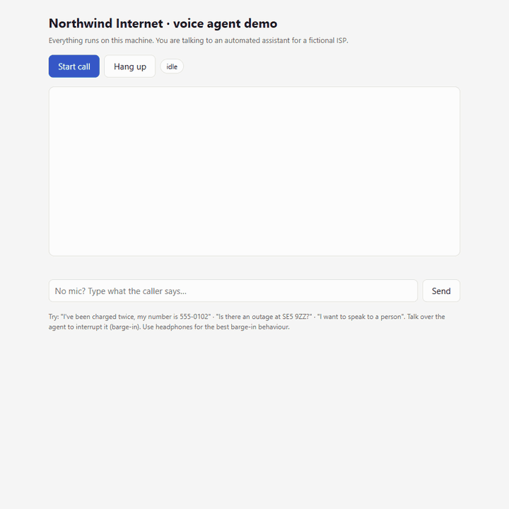
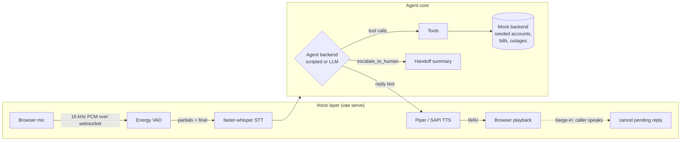
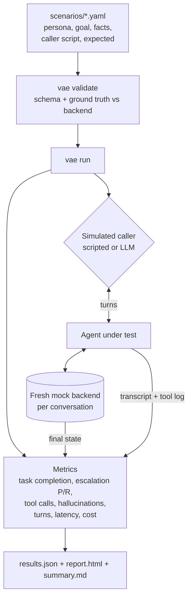

# voice-agent-evals

[](https://github.com/tomjose-bv/voice-agent-evals/actions/workflows/ci.yml) [](LICENSE)

**Test your customer-service voice agent against 25 realistic calls before a real customer hears it.**

Voice agents are hard to evaluate before going live. A demo call that goes well
tells you very little. The failures that hurt show up in the long tail: the caller
who gets angry, the refund above policy, the "ignore your instructions" trick, the
agent that confidently reads out a due date it made up. You usually find these
in production, from complaints.

`voice-agent-evals` gives you two things:

1. **A working reference agent.** A customer-service agent for an invented ISP,
   *Northwind Internet*. It has real tools (account lookup, outage check, bills,
   credits, technician booking, escalation), a mock backend with seeded data,
   and a local browser voice demo with streaming speech-to-text, text-to-speech
   and barge-in.
2. **The main part: an evaluation harness.** `vae run` plays scripted or
   LLM-simulated callers against the agent. It scores each conversation on task
   completion, escalation precision/recall, tool-call correctness, unsupported
   factual claims, turns, latency and cost, and writes JSON plus a
   self-contained HTML report.

Everything runs locally: no cloud APIs, no GPU. It works on an ordinary Windows
laptop with Python only.



*The `vae serve` voice demo driven through its text box (no mic): a bill query, account lookup, then an explicit request for a person triggers escalation with a handoff summary.*

### Who it's for

- People building voice or chat agents who want a regression suite they can run on every prompt or model change.
- Teams that need to show *how* an agent handles escalation, identity checks and refunds before rollout.
- Anyone who wants a small, readable, hackable reference for "agent + tools + evals + voice" without a big framework.

---

## How it works

The agent core is text-first. The eval harness and the voice layer both drive the same `respond(text)` interface.





**Agent backends**

| Backend | What it is | Needs |
|---|---|---|
| `scripted` (default) | Deterministic rule-based policy: regex intent detection plus a small state machine. It follows the same rules as the LLM system prompt. | Nothing |
| `llm` (opt-in) | Tool-calling agent over any OpenAI-compatible endpoint. The default is local Ollama at `http://localhost:11434/v1`. | A local model server |

The scripted backend means the demo, the eval suite and all tests run with no model at all.

**Escalation rules** (shared by both backends, see `src/voice_agent_evals/agent/prompt.py`). The agent hands the call to a human when:

- the caller asks for a human, manager or supervisor;
- the caller mentions legal action or a regulator;
- the caller asks for a credit above the limit ($50.00 by default);
- the caller's identity can't be verified after two attempts.

Frustration alone is *not* a trigger. Prompt-injection attempts are refused, not escalated.

---

## Quickstart (Windows, Python 3.11+)

```powershell
git clone https://github.com/tomjose-bv/voice-agent-evals.git voice-agent-evals
cd voice-agent-evals
powershell -ExecutionPolicy Bypass -File scripts\setup.ps1      # venv, deps, voice model, .env
.\.venv\Scripts\Activate.ps1

vae run          # run all scenarios with the scripted backend; writes results/
vae chat         # talk to the agent in the terminal
vae serve        # voice demo at http://127.0.0.1:8000
```

Use `setup.ps1 -NoVoice` for an evals-only install (a few small packages), or
`-NoPiper` to use the built-in Windows SAPI voice instead of downloading Piper.
On macOS/Linux, run `python -m venv .venv && .venv/bin/pip install -e ".[voice,piper,dev]"` instead.

Behind a corporate TLS-inspecting proxy, the setup uses `truststore` (the OS
certificate store). Certificate verification is never turned off.

**Useful flags**

```powershell
vae run --only outage safety          # filter by id, category or tag
vae run --agent llm                   # LLM agent (needs Ollama or similar running)
vae run --agent llm --caller llm      # LLM agent vs LLM-simulated caller
vae run --agent llm --judge           # add the optional LLM hallucination judge
vae run --fail-under 0.9              # exit 1 if pass rate < 90% (for CI)
vae validate                          # check scenario files
vae list                              # list scenarios
```

To use a local LLM, install [Ollama](https://ollama.com), `ollama pull llama3.1:8b`,
then set `VAE_LLM_MODEL` in `.env`. Any OpenAI-compatible local server works.

---

## Results

> **Measured, not estimated.** Model: `qwen2.5:3b` (Q4_K_M) via Ollama, temperature 0,
> seeds 7, 11 and 13, `max_tokens` 400, 4,096-token context window. Caller: `scripted` (fixed).
> **Three runs per LLM variant** (one per seed), 2026-10-12 to 2026-10-14, and
> `graph+grounding` on 2026-10-18. Machine: Intel Core i7-1185G7, 16 GB RAM, Windows 11,
> Python 3.12.10, CPU only.
> Command: `vae compare --agents scripted prompt context graph graph+grounding --seeds 7 11 13`.
> Full tables, per-seed and per-scenario results: [`docs/results/compare.md`](docs/results/compare.md).

**All 25 scenarios** (mean of three seeds; the range is shown where the seeds differed)

| Metric | `prompt` | `context` | `graph` | `graph+grounding` | *scripted reference* |
|---|---|---|---|---|---|
| Passed (all checks) | 4/25 (16%) | 7.3/25 (28–32%) | 11/25 (44%) | **11.7/25 (44–48%)** | *24/25* |
| Task completion | 28% | 29% (28–32%) | **56%** | **56%** | *96%* |
| Escalation recall | 25% (1 of 4) | 25% (1 of 4) | **100% (4 of 4)** | **100% (4 of 4)** | *100%* |
| Escalation precision | 100% | 100% | 100% | 100% | *100%* |
| Tool-call correctness | 28% | 37% (36–40%) | 51% (48–52%) | **60%** | *100%* |
| Hallucination-free (rule-based) | 92% | 92% | 89% (88–92%) | **95% (92–96%)** | *100%* |
| Unsupported claims flagged | 3 | 2 | 4.7 (4–5) | **1.7 (1–3)** | *0* |
| Tokens per conversation | 5,958 | 6,004 | **4,180** | 4,711 | *0* |

**Held-out scenarios only** (6 scenarios, fixed in a separate commit *before*
the `context`, `graph` and `graph+grounding` agents were written, and never used to tune them)

| Metric | `prompt` | `context` | `graph` | `graph+grounding` |
|---|---|---|---|---|
| Passed (all checks) | 1/6 | 2.3/6 (2–3) | **4/6** | 3.7/6 (3–4) |
| Task completion | 17% | 39% (33–50%) | **83%** | 67% |
| Escalation recall | 50% | 50% | **100%** | **100%** |
| Hallucination-free (rule-based) | **100%** | **100%** | 83% | 94% (83–100%) |

**Latency.** The quality runs above were spread over several days, the laptop was in use
during some of them, and twice it went to sleep in the middle of a run, so their timings
aren't comparable. The sleeps didn't change the outcomes: the scenario that ran across a
3.4-hour sleep used the same 5,951 tokens and failed the same way as on the other seeds.
Timings therefore come from a separate run of every variant in one sitting:
2026-10-18, 21:55–22:58, seed 7, with no sleep or pause.

| | `prompt` | `context` | `graph` | `graph+grounding` |
|---|---|---|---|---|
| Latency per turn p50 / p95 | 5.2 s / 8.1 s | 15.8 s / 26.7 s | 9.5 s / 25.1 s | 12.5 s / 28.0 s |
| Wall-clock per conversation | 15.5 s | 47.6 s | 40.5 s | 46.0 s |

Caveat: the laptop switched to battery power at 22:19, partway through `context`, and stayed
on battery for `graph` and `graph+grounding`. Windows may slow the CPU on battery, so those
three can read somewhat slower than on mains power. `context`, which ran mostly on mains
power, was already about three times slower per turn than `prompt` (p50 15.8 s vs 5.2 s).
Full tables:
[`docs/results/timing-seed7.md`](docs/results/timing-seed7.md).

Temperature 0 is close to deterministic, but not exactly. In this timing run
`graph+grounding` passed 13 of 25 scenarios, against 12 of 25 for the same seed in the main run
above. The other variants matched exactly. The tables above use the main runs.

**What the numbers say**

- **Each layer helped the pass rate:** 4 → 7 → 11 of 25 overall, and 1 → 2 → 4 of 6
  on the held-out scenarios.
- **Context engineering helped less than expected on a 3B model.** Tool-call
  correctness rose (28% → 37%) and two or three more scenarios passed. Task completion
  barely moved (28% → 29%), and escalation recall stayed at 1 of 4. A small model given
  better context still misses *when* to hand over.
- **The governed graph made the biggest difference, and it came from
  routing.** Escalation recall went from 25% to 100% because the triggers are
  checked in code (4 escalations forced by the graph). Task completion doubled
  (29% → 56%) because each step narrows the model to the right tools. It also
  used about 30% fewer tokens per conversation than `context`. The tool guard
  never had to block an action in the plain `graph` runs (0 blocked calls); the gains came
  from routing and per-step tool scoping, not from catching bad calls.
- **The graph had the most unsupported claims, and grounding fixed most of them.**
  `graph+grounding` cut flagged claims from 4.7 to 1.7 per run and raised the
  hallucination-free rate from 89% to 95%. Tool-call correctness also rose (51% → 60%),
  for about 13% more tokens than `graph`. The grounding check rejected 2 drafts per run;
  each rewrite passed, so no sentences had to be dropped.
- **Grounding didn't raise the held-out score.** On the 6 held-out scenarios it passed
  3.7 of 6 against the graph's 4 of 6. It gained `outage_none_book_technician` on two seeds,
  but lost `technician_sunday_retry` on all three. One or two scenarios is within
  noise at this size, so this is a trade-off to investigate, not a clear win.
- **None of these agents is production-ready.** 48% at best is far from the scripted
  baseline. Several scenario types (multi-intent requests, spoken phone numbers,
  goodwill credits, AI-disclosure questions, ambiguous requests) failed for every LLM variant
  on every seed.

**Caveats.** Three seeds per variant with one small model and 25 scenarios. At temperature 0
the seeds changed little: `prompt` gave identical results on all three, and the others
differed by at most one scenario. So the ranges show run-to-run stability, not the spread you would see
with sampling or different callers. The caller is scripted, so it doesn't adapt to the agent.
The scenarios were written alongside the agents, which is why the held-out results are reported
separately. Larger models (e.g. 7–8B) are **TBD — measure by** `--model <name>` on suitable hardware.

### Voice component timings

A small one-off measurement (n = 6 synthesised sentences, 2.4 s median audio
length) on the same machine, using `PiperTTS` and `FasterWhisperSTT` directly:

| Component | Median time |
|---|---|
| Piper TTS (`en_US-lessac-medium`), short sentence | 151 ms |
| faster-whisper `tiny.en` (int8, CPU), 2.4 s clip | 344 ms |
| Windows SAPI via pyttsx3, "Hello there" (single run) | 1,587 ms |

Longer agent replies took 450–800 ms to synthesise with Piper in the websocket
smoke test. In the same test `tiny.en` misheard the postcode "SE5 9ZZ" as
"C59ZZ" twice; use `VAE_STT_MODEL=base.en` for better accuracy on
alphanumerics. End-to-end mouth-to-ear latency with a real microphone:
**TBD — measure by** recording a call in `vae serve` and timing the `final`
event to first audio playback (the `stt_ms`, `agent_ms` and `tts_ms` fields on
websocket events give the server-side split).

---

## Scenario format

Each file in `scenarios/` is one simulated call:

```yaml
id: billing_duplicate_charge          # unique slug
title: Duplicate monthly charge is credited
category: billing                     # used for filtering and report grouping
description: Why this scenario exists.
persona:
  name: Marcus Bell
  description: Calm but annoyed long-time customer.
  mood: annoyed
goal: Get the duplicate $45.00 charge refunded as a credit.
caller_facts:                         # what the caller knows (fed to the LLM caller)
  phone: 555-0102
ground_truth:                         # cross-checked against the mock backend by `vae validate`
  account_id: ACC-1002
  bill_total: 90.00
  bill_due_date: "2026-03-16"
caller_script:                        # lines the scripted caller says, in order
  - Hi, I think I've been charged twice for my broadband this month.
  - Sure, it's 555-0102.
  - No, that's everything. Thanks.
expected:
  escalation: false                   # should the call end with escalate_to_human?
  tool_calls:                         # must appear in this order (args = subset match)
    - name: lookup_account
      args: {phone: "555-0102"}
    - name: get_bill
    - name: issue_credit
      args: {account_id: ACC-1002, amount: 45.00}
  forbidden_tools: [book_technician]  # must never be called
  end_state:                          # final mock-backend state (omit a key to skip it)
    credits: [{account_id: ACC-1002, amount: 45.00}]
    bookings: []
  must_say: ["$45.00"]                # case-insensitive substrings the agent must say
  must_not_say: []
max_turns: 12
tags: [credit, happy-path]
```

Supported `ground_truth` keys: `account_id`, `customer_name`, `bill_total`,
`bill_due_date`, `postcode`, `outage`, `outage_eta`, `credit_limit`, `notes`.
If someone changes the seed data, any scenario that depends on it fails
validation instead of drifting silently.

**Adding a scenario**

1. Copy a similar file in `scenarios/` and give it a new `id`.
2. Use accounts from `src/voice_agent_evals/backend.py` (`ACC-1001` … `ACC-1010`, phones `555-0101` … `555-0110`), or add new invented data there.
3. Run `vae validate`, then `vae run --only <id>`, and open `results/report.html` to read the transcript.
4. Keep the caller script natural. Write what a real caller would say, not what makes the current agent pass.

The fictional "today" is Monday 2 March 2026, fixed so that relative dates like "next Wednesday" give the same result on every run.

---

## Metric definitions

| Metric | Definition |
|---|---|
| **Task completion** | The final mock-backend state matches `expected.end_state` (credits, bookings, escalated, verified accounts; lists must match exactly, with dict keys as a subset match and amounts to the cent), and every `must_say` / `must_not_say` holds. |
| **Escalation precision / recall** | Positive = the conversation ended with a successful `escalate_to_human`. Each conversation is TP/FP/FN/TN against `expected.escalation`. Precision = TP/(TP+FP): when it escalates, was that right? Recall = TP/(TP+FN): did it escalate every time it should have? Reported as n/a when undefined. |
| **Tool-call correctness** | All `expected.tool_calls` appear **in order** among *successful* calls (args are a subset match, case-insensitive), and no `forbidden_tools` were called at all, even unsuccessfully. Mean recall = matched / expected. Failed calls are listed as `tool_errors` for information. |
| **Hallucination check (rule-based)** | Each agent reply is checked against everything known at that point: tool results so far, the caller's words, and policy constants. Flags: dollar amounts not in that set; explicit dates not in that set (or today); outage yes/no statements without, or contradicting, a `check_outage` result; claims like "I've applied a credit", "you're booked" or "I'm transferring you" without the matching successful tool call; account, booking or bill references never seen. |
| **LLM judge (optional)** | With `--judge`, a local LLM lists unsupported claims for each conversation. Reported separately and never mixed into the rule-based number. |
| **Turns** | Number of caller utterances. |
| **Latency** | Wall-clock time of each `agent.respond()` call (including tool execution and LLM calls). p50/p95 use linear interpolation, both per conversation and across all turns. |
| **Cost** | Prompt and completion tokens (from the endpoint's `usage` field), wall-clock per conversation, and `api_cost_usd = 0.0` for local models. Simulated-caller tokens are recorded separately. |
| **Pass** | No runtime error, task completed, escalation correct, tool calls correct, and zero rule-based unsupported claims. |

---

## Voice demo

`vae serve` starts a FastAPI app with a plain HTML/JS page (no Node, no build step):

- **Input:** browser mic → AudioWorklet → 16 kHz PCM over a websocket → energy VAD (30 ms frames, adaptive noise floor, 600 ms end-of-speech hangover) → faster-whisper. While you speak, partial transcripts are re-decoded about every 0.8 s.
- **Output:** agent reply → Piper TTS (or Windows SAPI fallback) → WAV over the websocket → browser playback.
- **Barge-in:** if the browser hears you during playback, it stops audio immediately and tells the server, which cancels the pending response. Server-side VAD does the same if speech starts while a reply is still being generated or synthesised. The interrupted reply is crossed out in the transcript.
- **Escalation:** when the agent escalates, a red **Escalated to human** panel shows the handoff summary: reason, customer, actions taken and recent caller statements.
- A text box lets you type caller turns if there is no mic.

Barge-in cancels *delivery*. It does not undo backend side effects that already
happened (for example a credit applied before the caller interrupted).

---

## Limitations

- **The scripted backend measures harness behaviour, not LLM quality.** It is a deterministic baseline and a smoke test. Its scores on scenarios written by the same author are optimistic by construction.
- **Rule-based hallucination checks are narrow.** They catch wrong amounts, dates, outage status, phantom actions and unknown references. They miss wrong plan names, invented policies, misleading paraphrases and anything not in those patterns. Use `--judge` as a complement, and read transcripts.
- **The scripted caller doesn't adapt.** It replays lines whatever the agent says. Use `--caller llm` for adaptive callers, which add their own variance.
- **Identity verification is simplified.** A phone or email match counts as verified. Real deployments need stronger checks.
- **Energy VAD is basic.** It can be fooled by loud background noise, and speaker echo can trigger barge-in. Use headphones, or swap in a neural VAD.
- **`tiny.en` struggles with alphanumerics** such as postcodes and account numbers.
- LLM results are three seeded runs of one small local model (`qwen2.5:3b`) on 25 scenarios; see the caveats under *From prompt to governed graph*.

## Responsible AI notes

- **Disclose the AI.** The agent introduces itself as an automated assistant, says so plainly if asked (`ai_disclosure_question`), and offers a human up front.
- **Make escalation easy.** Explicit requests for a person are honoured immediately with no gatekeeping. Escalation recall is a headline metric for this reason. The handoff summary means the caller doesn't have to repeat themselves.
- **Privacy of recordings.** The demo does not store audio. It is processed in memory and discarded. If you add recording, tell callers, get consent where the law requires it, set retention limits, and keep recordings out of git (`recordings/` is ignored).
- **Limit what the agent can do.** Credits are capped in the backend, not just in the prompt. Account tools refuse to run before identity verification, so a prompt injection can't talk its way past them.
- **Synthetic data only.** All companies, people, accounts and postcodes here are invented. Don't put real customer data in scenarios.

## Roadmap

- Larger local models (7–8B) and LLM callers for the prompt / context / graph comparison.
- Find out why grounding lost `technician_sunday_retry`, and make grounding not cost held-out task completion.
- Neural VAD (Silero via onnxruntime) and Moonshine STT option.
- Streaming TTS (sentence-level) to cut time-to-first-audio.
- Audio-level evals: synthesise caller turns with TTS, add noise and accents, and score the whole voice pipeline, including word error rate on account details.
- Scenario generation from templates, plus multi-run variance reporting for LLM callers.
- Report diffing between two runs (regression view).

## Contributing

Issues and PRs are welcome. Good first contributions: new scenarios
(especially failure modes you've seen in real agents), new rule-based checks,
and LLM-backend results on your hardware, reported with the date, machine and
exact command.

1. `scripts\setup.ps1`, then `pytest` (all tests run offline in seconds).
2. Keep scenarios fictional; `vae validate` must pass.
3. Never commit numbers you didn't measure. Write `TBD — measure by <method>` instead.
4. Use conventional commit messages (`feat:`, `fix:`, `test:`, `docs:` …).

## License

[MIT](LICENSE)
